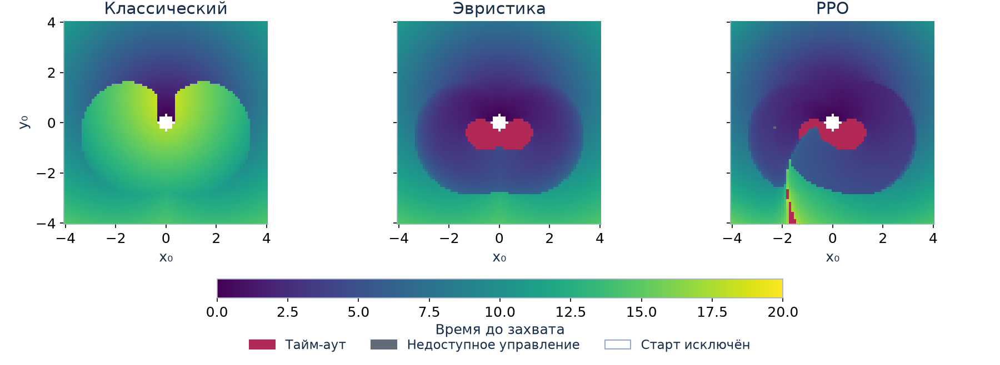
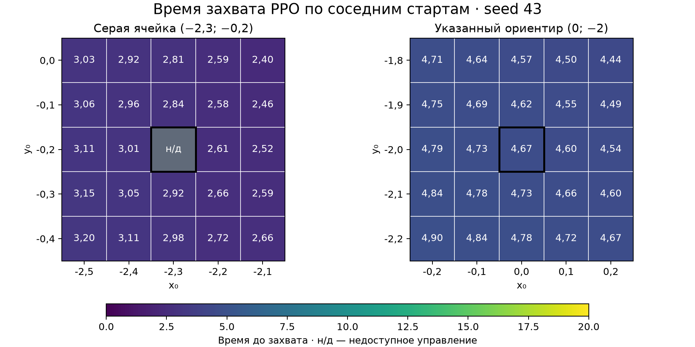

# Сравнение классического водителя, эвристики и PPO

Классический водитель захватил убегающего на всех 6 532 стартах. У PPO на 40 подтверждённых захватов больше, чем у эвристики. На 6 256 стартах, где оба достигли захвата, PPO в среднем опередил эвристику на 0,372 единицы модельного времени. [Сводка парных сравнений](../data/evaluation-wide-potential-262144-seed-43/summary.md)

## Массовая оценка

Все три водителя начинали из одних и тех же точек сетки против классического убегающего (`classical_evader`). Захват фиксировался при первом контакте, горизонт эпизода составлял 20 единиц модельного времени. Среднее время в таблице рассчитано по успешным эпизодам каждого водителя. [Результаты по эпизодам](../data/evaluation-wide-potential-262144-seed-43/episodes.csv) · [Параметры и сводные метрики](../data/evaluation-wide-potential-262144-seed-43/summary.json)

| Водитель | Захваты | Лимит времени | Исход не определён | Доля захватов | Среднее время до захвата |
| --- | ---: | ---: | ---: | ---: | ---: |
| Классический | 6 532 | 0 | 0 | 100,00 % | 10,788 |
| Эвристика | 6 278 | 254 | 0 | 96,11 % | 6,946 |
| PPO | 6 318 | 213 | 1 | 96,72–96,74 % | 6,544 |

Для PPO нижняя граница учитывает 6 318 подтверждённых захватов. Верхняя допускает захват и в единственном эпизоде со статусом `unsupported`. Знаменатель в обоих случаях — 6 532 старта.

### Время захвата по начальным координатам

Каждая ячейка соответствует одному старту (x₀, y₀). На всех трёх картах цвет показывает время до захвата по общей шкале от 0 до 20. Малиновым отмечены тайм-ауты, серым — недоступное управление, белым — исключённые старты в круге захвата и на его границе.

#### Серая ячейка на карте PPO

Единственный старт со статусом `unsupported` имеет координаты **(−2,3; −0,2)**. Для PPO время захвата здесь отсутствует. Из той же точки классический водитель достиг захвата при t = 14,009, эвристика — при t = 2,738. В точке **(0; −2)** PPO достиг захвата при t = 4,673.

Каждая панель показывает 25 исходных ячеек с шагом 0,1. Рамка выделяет центральный старт, числа показывают время захвата с точностью до сотых. Серый цвет обозначает недоступное управление. [Записи массовой оценки](../data/evaluation-wide-potential-262144-seed-43/episodes.csv)

#### Повтор эпизода из серой ячейки

На панелях x(t), y(t), y(x), φ(t) и ψ(t) показаны три водителя против одного классического убегающего. Кривые PPO заканчиваются раньше других. В момент остановки, t = 2,609972, расстояние до начала координат равно 0,372842 при радиусе захвата 0,3. Для сравнения, эвристика достигает захвата при t = 2,737590, классический водитель — при t = 14,008591. Тест использует тот же checkpoint, детерминированные действия и протокол первого контакта, что и массовая оценка. [Тест воспроизведения](../tests/test_ppo_gray_cell.py)

**Почему оборвалась зелёная кривая.** При t = 2,582461 PPO выбрал φ = −1. Классическая обратная связь находилась на ветви `primary` и дала убегающему курс ψ = 0,924607. Шаг закончился на особой линии `SE` в точке (0,193264531; 0,318841889). На следующем решении PPO снова выдал φ = −1, но функция `classical_feedback` вернула `None`. Без курса ψ функция `step_feedback` выставила `unsupported` с нулевой длительностью шага. На графике показаны только фактически пройденные интервалы. [Обратная связь и обработка шага](../chauffeur_evader/chauffeur_classical.py)

**Где возник разрыв.** В конечной точке проверка близости к точному барьеру даёт расстояние около 3,10·10⁻⁸ при допуске 2·10⁻⁸. Ветвь барьера пропускается. Геометрический классификатор возвращает `slow_side=False`, после чего код проверяет `_primary` и `_upper`. У первой минимальная невязка 9,74·10⁻⁹ превышает порог 10⁻¹⁴, у второй нет корня для дуги к оси. Так вблизи барьера остаётся состояние без классического ответа. Расчёт на этом оборвался до захвата и до горизонта T = 20. [Классификатор геометрии](../chauffeur_evader/chauffeur_theory.py) · [Выбор ветви](../chauffeur_evader/chauffeur_classical.py)

## Параметры PPO

Для массовой оценки и восьми реперных точек использован один checkpoint `ppo-262144.zip`. Метаданные указывают seed обучения **43**, **262 144 шага**, архитектуру `wide` и вариант награды `potential`. При оценке модель выбирала действия детерминированно на CPU. SHA-256 файла — `090c5eb6950216a38cb896fca4cf349e43b5bf3c669e9dc48029111406581847`. [Checkpoint](../data/chauffeur-task10/length-wide-potential/seed-43/ppo-262144.zip) · [Метаданные реперных траекторий](../data/evaluation-benchmarks/benchmark_run.json)

## Траектории на восьми реперных точках

Панели x(t) и y(t) показывают относительные координаты во времени, y(x) — траекторию на плоскости. На панели φ(t) показана угловая скорость поворота водителя, на ψ(t) — относительный курс убегающего. Цвет и тип линии обозначают водителя. Во всех трёх эпизодах каждой точки убегающий действует по одной и той же классической стратегии. [Данные траекторий](../data/evaluation-benchmarks/benchmarks.csv) · [Код построения фигур](../chauffeur_evader/chauffeur_benchmarks.py)

### P1 · старт (0, 2.3)

На графиках x(t), y(t), y(x), φ(t) и ψ(t) сопоставлены классический водитель, эвристика и PPO против одного и того же классического убегающего. Классический водитель и эвристика достигли захвата при t = 4,000, PPO — при t = 2,836.

### P2 · старт (1, 2.5)

На графиках x(t), y(t), y(x), φ(t) и ψ(t) сопоставлены классический водитель, эвристика и PPO против одного и того же классического убегающего. Время захвата составило 4,806 у классического водителя и эвристики и 3,784 у PPO.

### P3 · старт (0.2, 1)

На графиках x(t), y(t), y(x), φ(t) и ψ(t) сопоставлены классический водитель, эвристика и PPO против одного и того же классического убегающего. PPO достиг захвата при t = 1,045, классический водитель и эвристика — при t = 1,443.

### P4 · старт (0.45, 1)

На графиках x(t), y(t), y(x), φ(t) и ψ(t) сопоставлены классический водитель, эвристика и PPO против одного и того же классического убегающего. Классический водитель достиг захвата при t = 18,147, эвристика — при 1,461, PPO — при 1,037.

### P5 · старт (0.5, 0)

На графиках x(t), y(t), y(x), φ(t) и ψ(t) сопоставлены классический водитель, эвристика и PPO против одного и того же классического убегающего. Только классический водитель достиг захвата (t = 17,351). У эвристики и PPO эпизоды завершились по лимиту времени (t = 20).

### P6 · старт (2, -0.5)

На графиках x(t), y(t), y(x), φ(t) и ψ(t) сопоставлены классический водитель, эвристика и PPO против одного и того же классического убегающего. Эвристика и PPO достигли захвата почти одновременно (t = 2,698 и 2,671 соответственно). У классического водителя захват произошёл при t = 14,302.

### P7 · старт (3.2, -1.8)

На графиках x(t), y(t), y(x), φ(t) и ψ(t) сопоставлены классический водитель, эвристика и PPO против одного и того же классического убегающего. У классического водителя и эвристики время захвата составило 9,954, у PPO — 9,117.

### P8 · старт (0, -1)

На графиках x(t), y(t), y(x), φ(t) и ψ(t) сопоставлены классический водитель, эвристика и PPO против одного и того же классического убегающего. Эвристика и PPO достигли захвата при t = 4,613 с точностью до тысячных. Классический водитель достиг захвата при t = 15,905.
