# Сравнение классического водителя, эвристики и PPO

<!-- clearance-0001:begin -->

## Новый протокол с зазором 0,001

Финальная оценка · общая сетка 6 532 стартов.

Классический пешеход, γ игры = 0,5, β = 0,3, шаг до 0,05, первый контакт, T = 20. Оба PPO действуют детерминированно на CPU. Для отчёта заранее зафиксирован seed 43 и бюджет 262 144 решений.

- **Новый PPO** обучен с зазором 0,001. Веса `data/ppo-clearance-0001/task09-pdl/full-after-07/seed-43/ppo-262144.zip`, SHA-256 `4bf6c421f6be879571c0dbfe184304f284bf225856289a0666f667e08d9641d2`. Настройки `data/ppo-clearance-0001/task09-pdl/full-after-07/seed-43/settings.json`.
- **Архивный PPO** обучен с зазором 0,0. Веса `data/chauffeur-task10/length-wide-potential/seed-43/ppo-262144.zip`, SHA-256 `090c5eb6950216a38cb896fca4cf349e43b5bf3c669e9dc48029111406581847`. Настройки `experiments/chauffeur-task10-v1/protocol.json`.

[Эпизоды](../data/ppo-clearance-0001/task09-driver-report/episodes.csv) · [Траектории](../data/ppo-clearance-0001/task09-driver-report/trajectories.csv) · [Манифест весов и результатов](../data/ppo-clearance-0001/task09-driver-report/manifest.json)

### Сетка

| Водитель | Захваты | Тайм-ауты | Unsupported | Доля подтверждённых | Среднее время захвата (n) |
| --- | ---: | ---: | ---: | ---: | ---: |
| Классический | 6532 | 0 | 0 | 100,00 % | 10,943595 (6532) |
| Эвристика | 4043 | 2489 | 0 | 61,90 % | 8,752302 (4043) |
| Архивный PPO | 5 | 6527 | 0 | 0,08 % | 0,187609 (5) |
| Новый PPO | 4045 | 2487 | 0 | 61,93 % | 8,818846 (4045) |

Средняя разность времени считается только на стартах с захватом у обоих водителей. Столбец «Общие захваты» показывает знаменатель.

| Кандидат | Эталон | Общие захваты | Среднее t кандидата − t эталона |
| --- | --- | ---: | ---: |
| Эвристика | Классический | 4043 | -0,000030 |
| Архивный PPO | Классический | 5 | +0,001524 |
| Новый PPO | Классический | 4045 | +0,064559 |
| Архивный PPO | Эвристика | 5 | +0,001524 |
| Новый PPO | Эвристика | 4043 | +0,062668 |
| Новый PPO | Архивный PPO | 5 | -0,001507 |

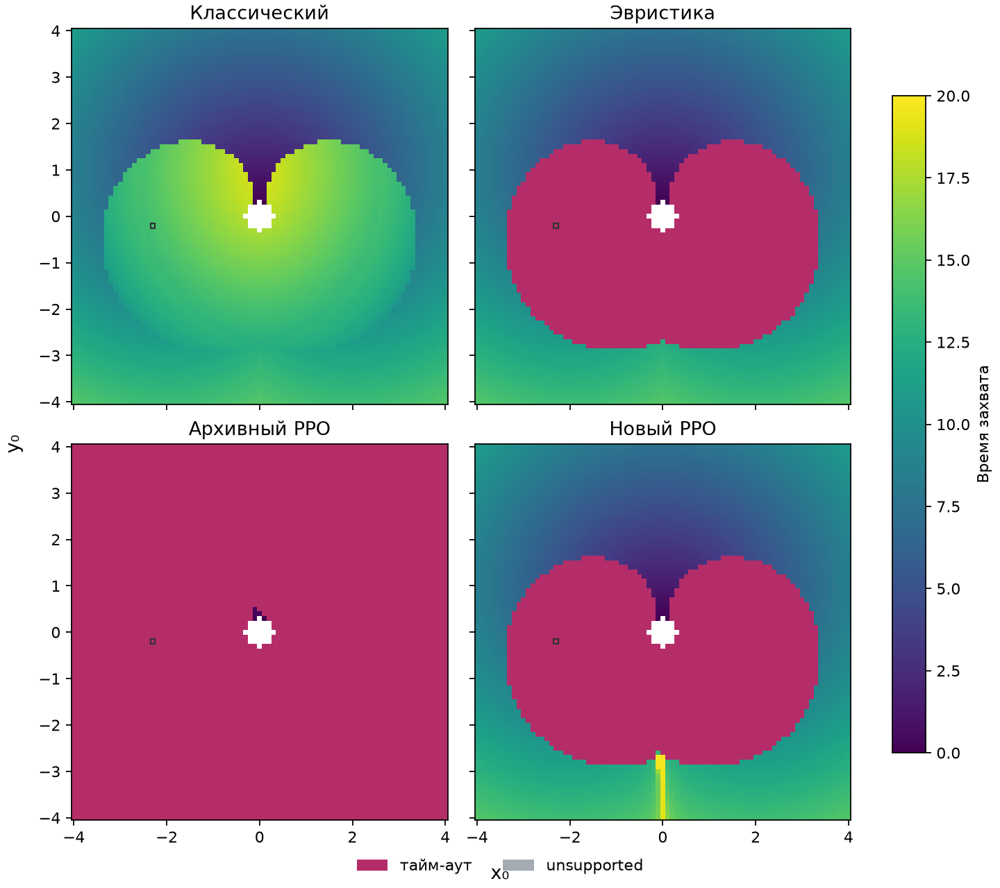

Малиновый цвет обозначает тайм-аут, серый — unsupported. Белые ячейки лежат внутри круга захвата или на его границе.

### Бывшая серая ячейка (−2,3; −0,2)

При исторической оценке с зазором 0 архивный PPO завершился на SE при t = 2,609972 с unsupported. Ниже тот же старт при зазоре 0,001.

| Водитель | Исход | t конца | min r на сохранённых состояниях | Последнее записанное событие | Шагов 0 < Δt < 0,001 |
| --- | --- | ---: | ---: | --- | ---: |
| Классический | захват | 14,139592 | 0,300000 | `contact` в 14,139592 | 1 |
| Эвристика | тайм-аут | 20,000000 | 0,301000 | `M` в 3,839997 | 0 |
| Архивный PPO | тайм-аут | 20,000000 | 0,301000 | `axis` в 4,443790 | 0 |
| Новый PPO | тайм-аут | 20,000000 | 0,301000 | `M` в 3,839997 | 0 |

Первый руль φ и события в каждой траектории.

- Классический · φ = +1,000000, `axis` при t = 1,202976, `virtual_entry` при t = 14,137592.
- Эвристика · φ = -1,000000, `barrier` при t = 1,911838, `safe_contact` при t = 2,643503.
- Архивный PPO · φ = -1,000000, `barrier` при t = 1,911838, `safe_contact` при t = 2,643503, `axis` при t = 4,443790.
- Новый PPO · φ = -1,000000, `barrier` при t = 1,911838, `safe_contact` при t = 2,643503.

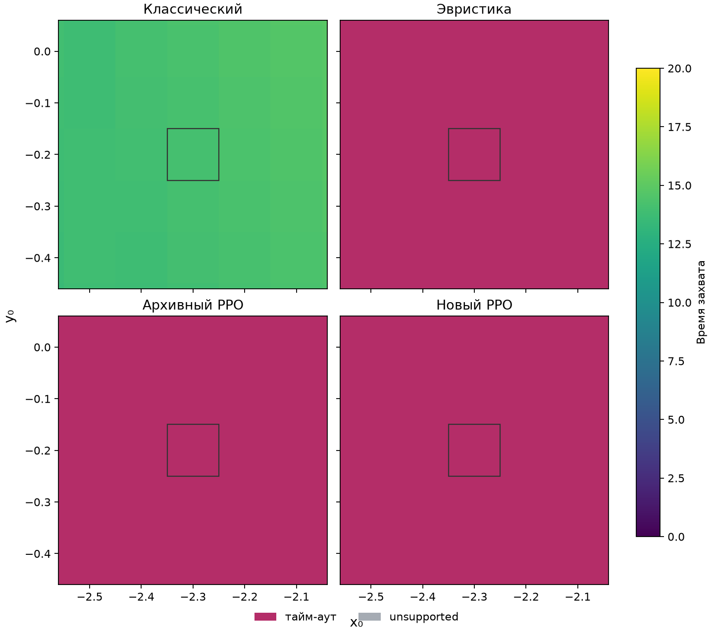

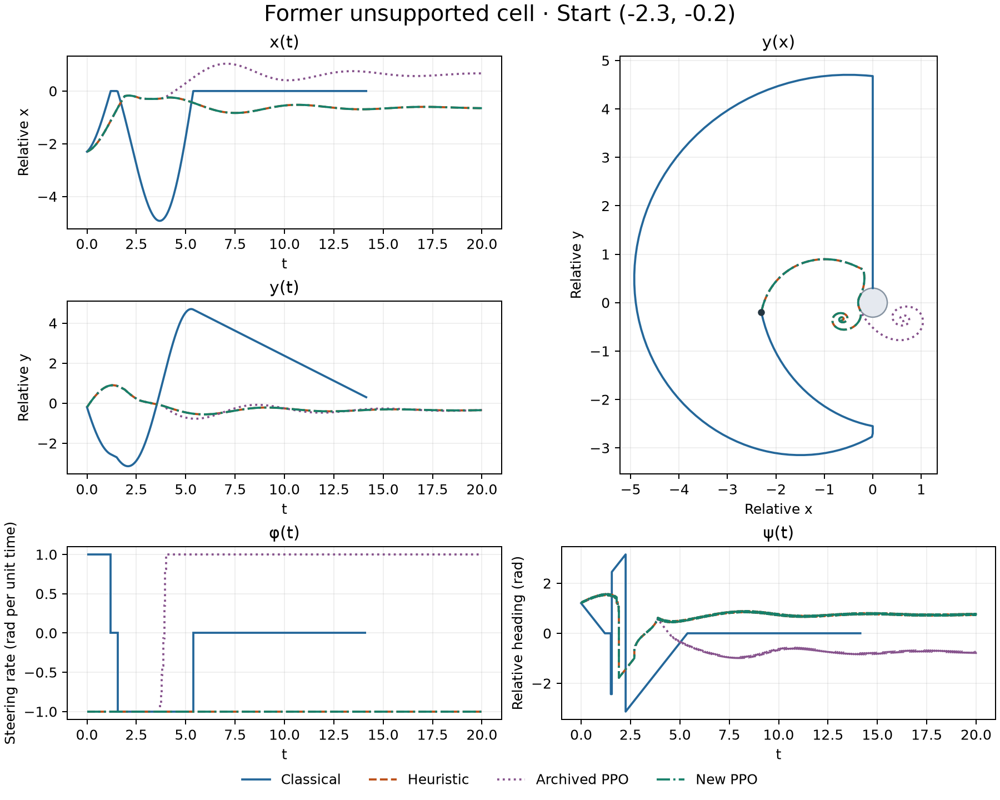

### Реперы P1–P8

| Репер | Старт (x₀, y₀) | Классический | Эвристика | Архивный PPO | Новый PPO |
| --- | --- | ---: | ---: | ---: | ---: |
| P1 | (0, 2.3) | 4,000000 | 4,000000 | тайм-аут | 4,005649 |
| P2 | (1, 2.5) | 4,805609 | 4,805611 | тайм-аут | 4,812831 |
| P3 | (0.2, 1) | 1,442629 | 1,442633 | тайм-аут | 1,443488 |
| P4 | (0.45, 1) | 18,277614 | тайм-аут | тайм-аут | тайм-аут |
| P5 | (0.5, 0) | 17,482090 | тайм-аут | тайм-аут | тайм-аут |
| P6 | (2, -0.5) | 14,432693 | тайм-аут | тайм-аут | тайм-аут |
| P7 | (3.2, -1.8) | 9,953690 | 9,953693 | тайм-аут | 9,974951 |
| P8 | (0, -1) | 16,036021 | тайм-аут | тайм-аут | тайм-аут |

Средняя разность времени считается только на стартах с захватом у обоих водителей. Столбец «Общие захваты» показывает знаменатель.

| Кандидат | Эталон | Общие захваты | Среднее t кандидата − t эталона |
| --- | --- | ---: | ---: |
| Эвристика | Классический | 4 | +0,000002 |
| Архивный PPO | Классический | 0 | — |
| Новый PPO | Классический | 4 | +0,008748 |
| Архивный PPO | Эвристика | 0 | — |
| Новый PPO | Эвристика | 4 | +0,008746 |
| Новый PPO | Архивный PPO | 0 | — |

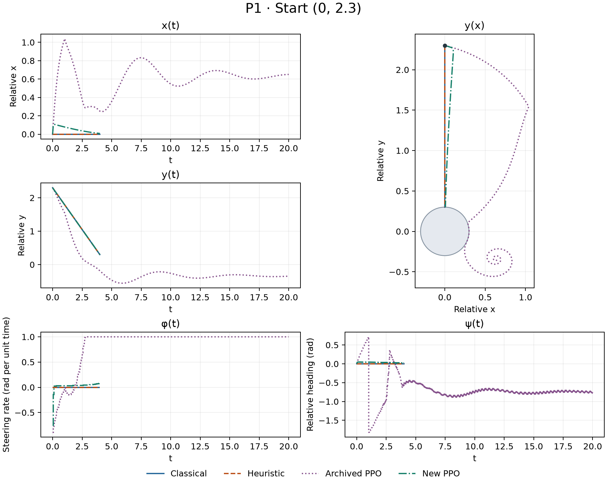

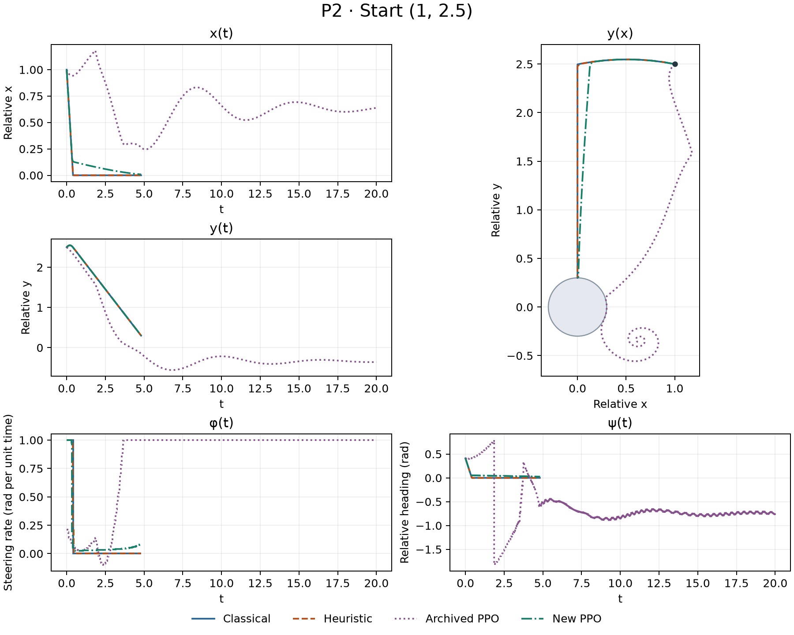

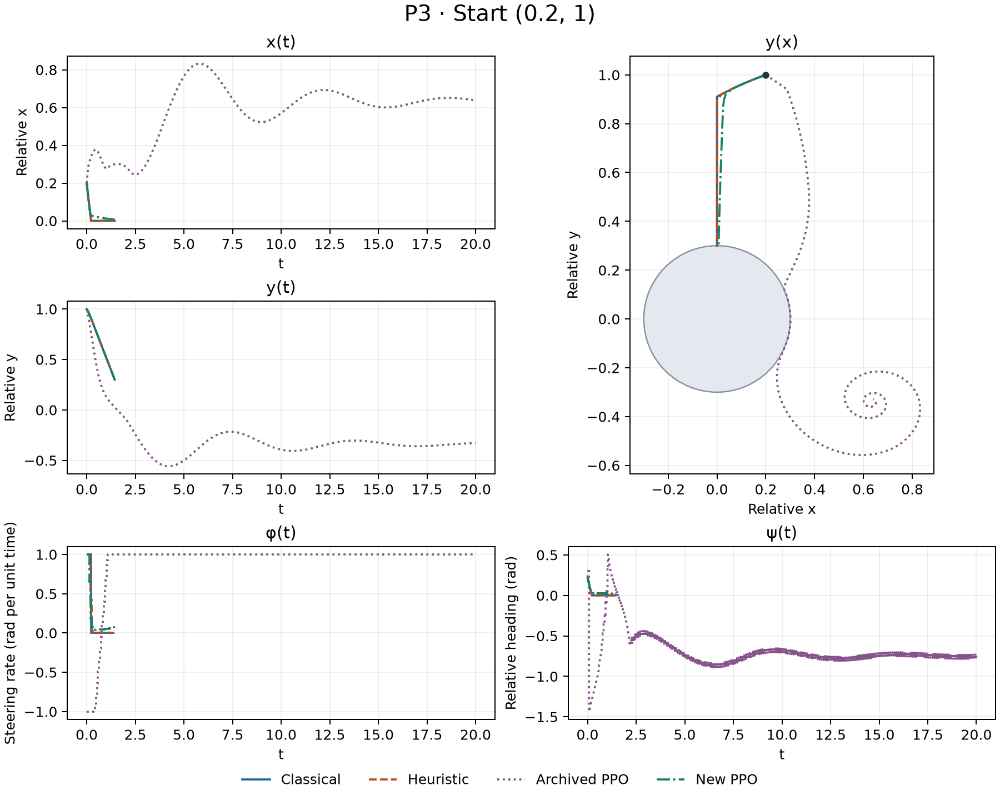

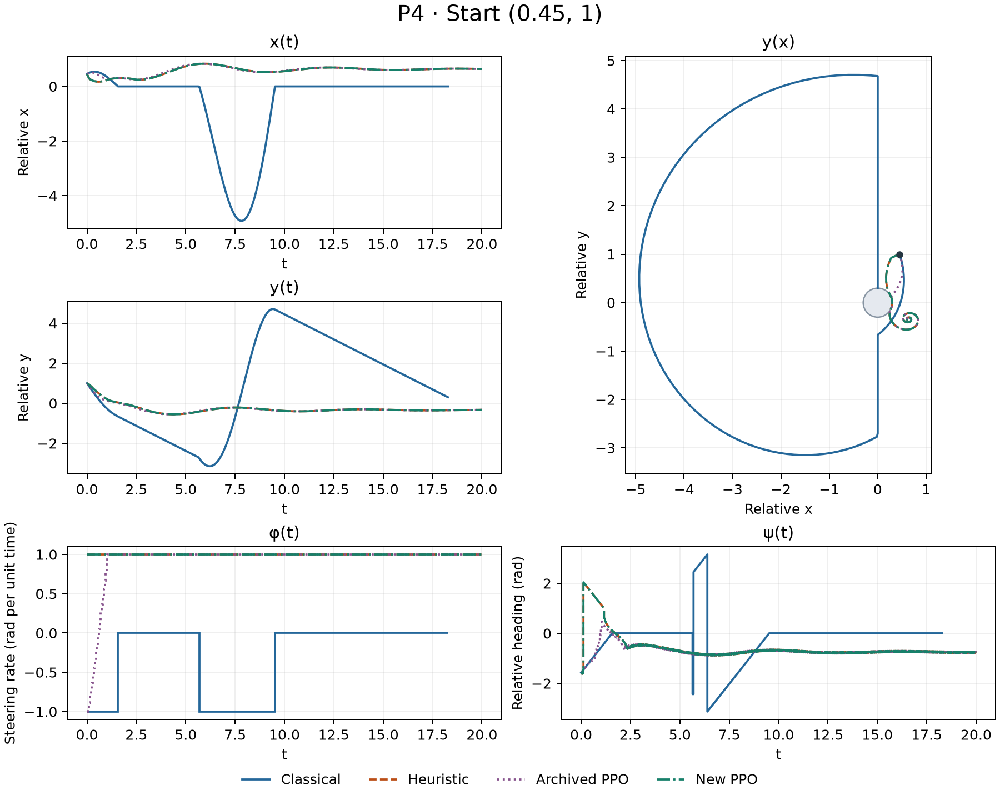

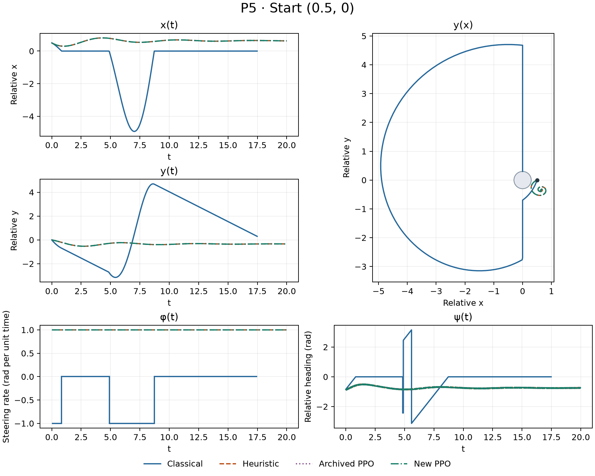

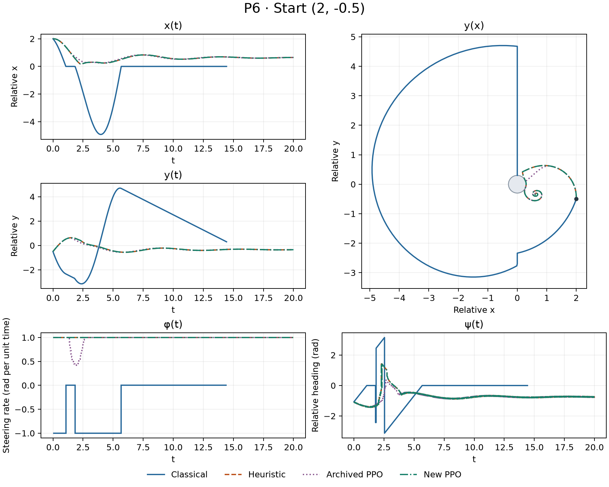

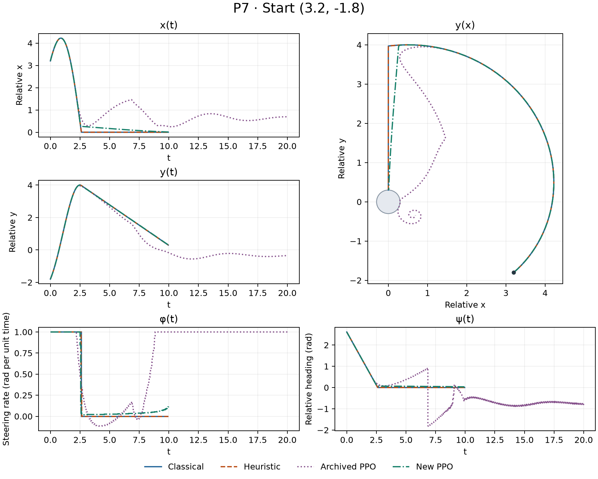

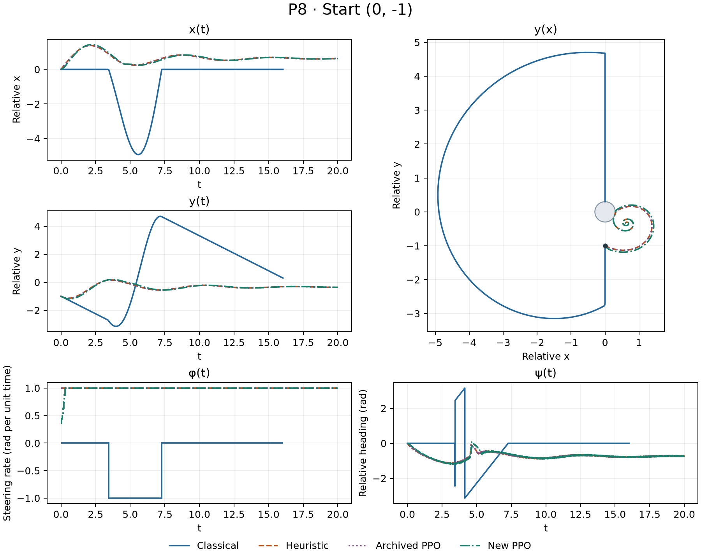

### Tuning · 512 стартов

Обе серии оценены на исправленном пешеходе с зазором 0,001, попарно по seed, бюджету и старту. «+ / −» считает подтверждённые захваты только одной политики.

Подтверждённые захваты эталонов. Классический — 512/512, Эвристика — 311/512, Архивный PPO — 0/512.

| Решения | Seed | 08 · захваты / тайм-ауты / unsupported | 09 · захваты / тайм-ауты / unsupported | + / − к 08 | Общие захваты | Среднее t₀₉ − t₀₈ |
| ---: | ---: | ---: | ---: | ---: | ---: | ---: |
| 131072 | 17 | 312 / 200 / 0 | 306 / 206 / 0 | 4 / 10 | 302 | +0,264114 |
| 131072 | 29 | 0 / 512 / 0 | 10 / 502 / 0 | 10 / 0 | 0 | — |
| 131072 | 43 | 305 / 207 / 0 | 313 / 199 / 0 | 9 / 1 | 304 | -0,016050 |
| 262144 | 17 | 311 / 201 / 0 | 313 / 199 / 0 | 2 / 0 | 311 | +0,085608 |
| 262144 | 29 | 0 / 512 / 0 | 268 / 244 / 0 | 268 / 0 | 0 | — |
| 262144 | 43 | 311 / 201 / 0 | 311 / 201 / 0 | 2 / 2 | 309 | -0,167937 |

- 131072 решений. 08 в среднем 205,67 из 512 (40,17 %), диапазон 0–312 (0,00–60,94 %). 09 в среднем 209,67 из 512 (40,95 %), диапазон 10–313 (1,95–61,13 %).
- 262144 решений. 08 в среднем 207,33 из 512 (40,49 %), диапазон 0–311 (0,00–60,74 %). 09 в среднем 297,33 из 512 (58,07 %), диапазон 268–313 (52,34–61,13 %).

[Парные исходы и времена по стартам](../data/ppo-clearance-0001/task09-driver-report/tuning-pairs.csv)

<!-- clearance-0001:end -->

## Исторический протокол без зазора

Таблицы, карты и реперы этого раздела получены при явно заданном `clearance=0`. Захват при первом контакте, классический пешеход, γ = 0,5, β = 0,3, шаг до 0,05 и T = 20. Детерминированный PPO с seed 43 обучен при нулевом зазоре. Тот же зазор использовался для исторических экспериментов задачи 10. [Общие функции 10](../chauffeur_evader/chauffeur_task10/common.py) · [Сравнение с контролем 10](../chauffeur_evader/chauffeur_task10/compare_control.py)

Классический водитель захватил убегающего на всех 6 532 стартах. У PPO на 40 подтверждённых захватов больше, чем у эвристики. На 6 256 стартах, где оба достигли захвата, PPO в среднем опередил эвристику на 0,372 единицы модельного времени. [Сводка парных сравнений](../data/evaluation-wide-potential-262144-seed-43/summary.md)

### Массовая оценка

Все три водителя начинали из одних и тех же точек сетки против классического убегающего (`classical_evader`). Захват фиксировался при первом контакте, горизонт эпизода составлял 20 единиц модельного времени. Среднее время в таблице рассчитано по успешным эпизодам каждого водителя. [Результаты по эпизодам](../data/evaluation-wide-potential-262144-seed-43/episodes.csv) · [Параметры и сводные метрики](../data/evaluation-wide-potential-262144-seed-43/summary.json)

| Водитель | Захваты | Лимит времени | Исход не определён | Доля захватов | Среднее время до захвата |
| --- | ---: | ---: | ---: | ---: | ---: |
| Классический | 6 532 | 0 | 0 | 100,00 % | 10,788 |
| Эвристика | 6 278 | 254 | 0 | 96,11 % | 6,946 |
| PPO | 6 318 | 213 | 1 | 96,72–96,74 % | 6,544 |

Для PPO нижняя граница учитывает 6 318 подтверждённых захватов. Верхняя допускает захват и в единственном эпизоде со статусом `unsupported`. Знаменатель в обоих случаях — 6 532 старта.

#### Время захвата по начальным координатам

Каждая ячейка соответствует одному старту (x₀, y₀). На всех трёх картах цвет показывает время до захвата по общей шкале от 0 до 20. Малиновым отмечены тайм-ауты, серым — недоступное управление, белым — исключённые старты в круге захвата и на его границе.

##### Серая ячейка на карте PPO

Единственный старт со статусом `unsupported` имеет координаты **(−2,3; −0,2)**. Для PPO время захвата здесь отсутствует. Из той же точки классический водитель достиг захвата при t = 14,009, эвристика — при t = 2,738. В точке **(0; −2)** PPO достиг захвата при t = 4,673.

Каждая панель показывает 25 исходных ячеек с шагом 0,1. Рамка выделяет центральный старт, числа показывают время захвата с точностью до сотых. Серый цвет обозначает недоступное управление. [Записи массовой оценки](../data/evaluation-wide-potential-262144-seed-43/episodes.csv)

##### Повтор эпизода из серой ячейки

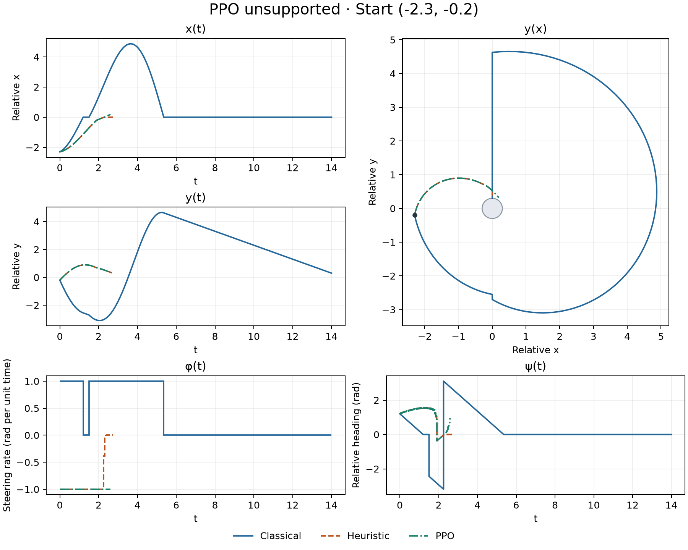

На панелях x(t), y(t), y(x), φ(t) и ψ(t) показаны три водителя против одного классического убегающего. Кривые PPO заканчиваются раньше других. В момент остановки, t = 2,609972, расстояние до начала координат равно 0,372842 при радиусе захвата 0,3. Для сравнения, эвристика достигает захвата при t = 2,737590, классический водитель — при t = 14,008591. Тест использует тот же checkpoint, детерминированные действия и протокол первого контакта, что и массовая оценка. [Тест воспроизведения](../tests/test_ppo_gray_cell.py)

**Почему оборвалась зелёная кривая.** При t = 2,582461 PPO выбрал φ = −1. Классическая обратная связь находилась на ветви `primary` и дала убегающему курс ψ = 0,924607. Шаг закончился на особой линии `SE` в точке (0,193264531; 0,318841889). На следующем решении PPO снова выдал φ = −1, но функция `classical_feedback` вернула `None`. Без курса ψ функция `step_feedback` выставила `unsupported` с нулевой длительностью шага. На графике показаны только фактически пройденные интервалы. [Обратная связь и обработка шага](../chauffeur_evader/chauffeur_classical.py)

**Где возник разрыв.** В конечной точке проверка близости к точному барьеру даёт расстояние около 3,10·10⁻⁸ при допуске 2·10⁻⁸. Ветвь барьера пропускается. Геометрический классификатор возвращает `slow_side=False`, после чего код проверяет `_primary` и `_upper`. У первой минимальная невязка 9,74·10⁻⁹ превышает порог 10⁻¹⁴, у второй нет корня для дуги к оси. Так вблизи барьера остаётся состояние без классического ответа. Расчёт на этом оборвался до захвата и до горизонта T = 20. [Классификатор геометрии](../chauffeur_evader/chauffeur_theory.py) · [Выбор ветви](../chauffeur_evader/chauffeur_classical.py)

### Параметры PPO

Для массовой оценки и восьми реперных точек использован один checkpoint `ppo-262144.zip`. Метаданные указывают seed обучения **43**, **262 144 шага**, архитектуру `wide` и вариант награды `potential`. При оценке модель выбирала действия детерминированно на CPU. SHA-256 файла — `090c5eb6950216a38cb896fca4cf349e43b5bf3c669e9dc48029111406581847`. [Checkpoint](../data/chauffeur-task10/length-wide-potential/seed-43/ppo-262144.zip) · [Метаданные реперных траекторий](../data/evaluation-benchmarks/benchmark_run.json)

### Траектории на восьми реперных точках

Панели x(t) и y(t) показывают относительные координаты во времени, y(x) — траекторию на плоскости. На панели φ(t) показана угловая скорость поворота водителя, на ψ(t) — относительный курс убегающего. Цвет и тип линии обозначают водителя. Во всех трёх эпизодах каждой точки убегающий действует по одной и той же классической стратегии. [Данные траекторий](../data/evaluation-benchmarks/benchmarks.csv) · [Код построения фигур](../chauffeur_evader/chauffeur_benchmarks.py)

#### P1 · старт (0, 2.3)

На графиках x(t), y(t), y(x), φ(t) и ψ(t) сопоставлены классический водитель, эвристика и PPO против одного и того же классического убегающего. Классический водитель и эвристика достигли захвата при t = 4,000, PPO — при t = 2,836.

#### P2 · старт (1, 2.5)

На графиках x(t), y(t), y(x), φ(t) и ψ(t) сопоставлены классический водитель, эвристика и PPO против одного и того же классического убегающего. Время захвата составило 4,806 у классического водителя и эвристики и 3,784 у PPO.

#### P3 · старт (0.2, 1)

На графиках x(t), y(t), y(x), φ(t) и ψ(t) сопоставлены классический водитель, эвристика и PPO против одного и того же классического убегающего. PPO достиг захвата при t = 1,045, классический водитель и эвристика — при t = 1,443.

#### P4 · старт (0.45, 1)

На графиках x(t), y(t), y(x), φ(t) и ψ(t) сопоставлены классический водитель, эвристика и PPO против одного и того же классического убегающего. Классический водитель достиг захвата при t = 18,147, эвристика — при 1,461, PPO — при 1,037.

#### P5 · старт (0.5, 0)

На графиках x(t), y(t), y(x), φ(t) и ψ(t) сопоставлены классический водитель, эвристика и PPO против одного и того же классического убегающего. Только классический водитель достиг захвата (t = 17,351). У эвристики и PPO эпизоды завершились по лимиту времени (t = 20).

#### P6 · старт (2, -0.5)

На графиках x(t), y(t), y(x), φ(t) и ψ(t) сопоставлены классический водитель, эвристика и PPO против одного и того же классического убегающего. Эвристика и PPO достигли захвата почти одновременно (t = 2,698 и 2,671 соответственно). У классического водителя захват произошёл при t = 14,302.

#### P7 · старт (3.2, -1.8)

На графиках x(t), y(t), y(x), φ(t) и ψ(t) сопоставлены классический водитель, эвристика и PPO против одного и того же классического убегающего. У классического водителя и эвристики время захвата составило 9,954, у PPO — 9,117.

#### P8 · старт (0, -1)

На графиках x(t), y(t), y(x), φ(t) и ψ(t) сопоставлены классический водитель, эвристика и PPO против одного и того же классического убегающего. Эвристика и PPO достигли захвата при t = 4,613 с точностью до тысячных. Классический водитель достиг захвата при t = 15,905.
