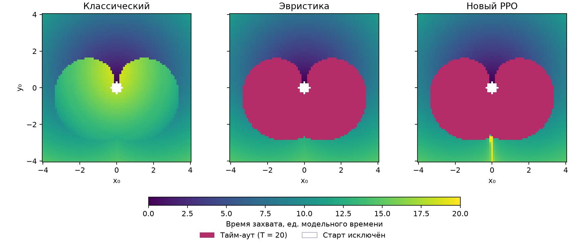
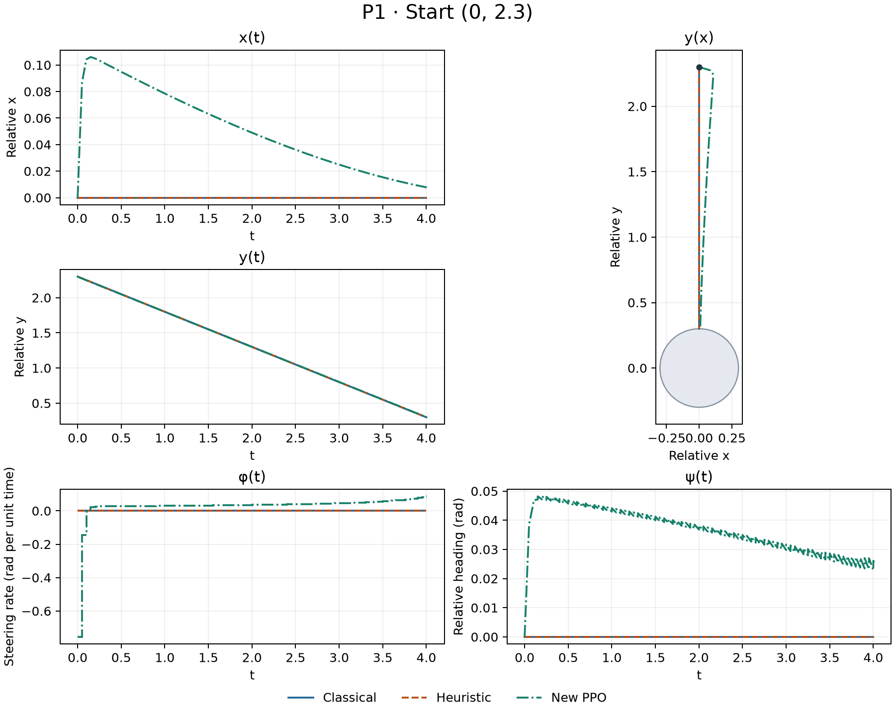
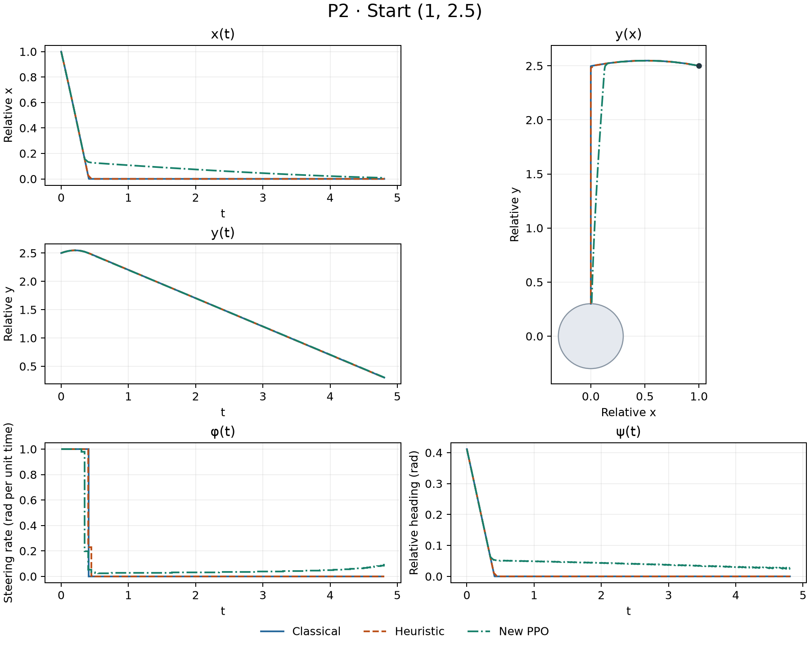
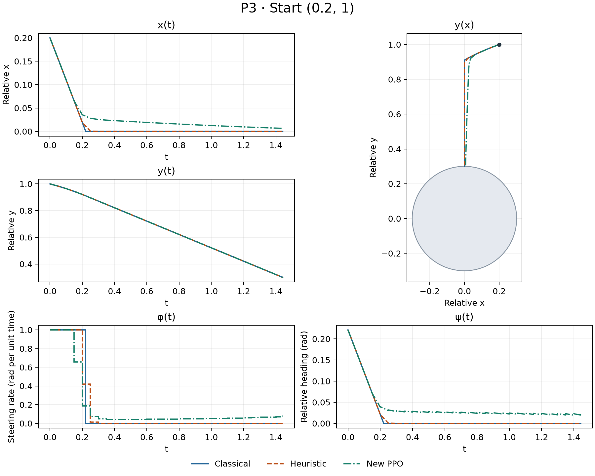
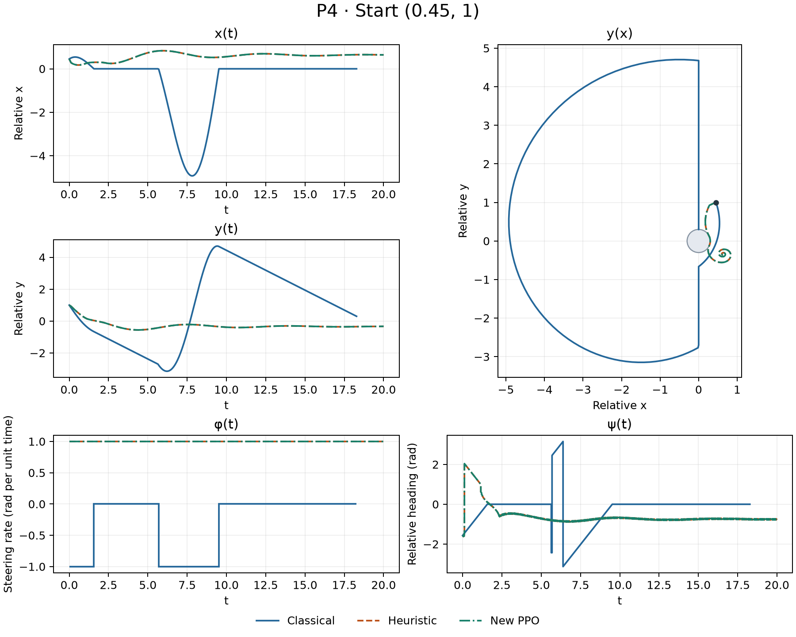
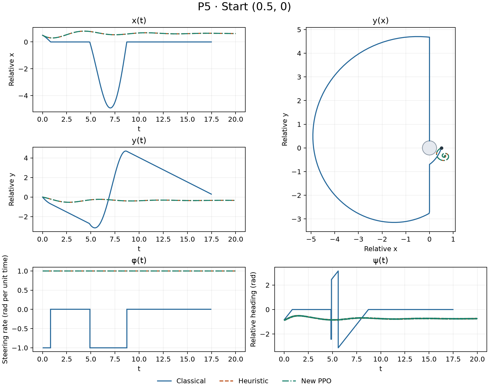
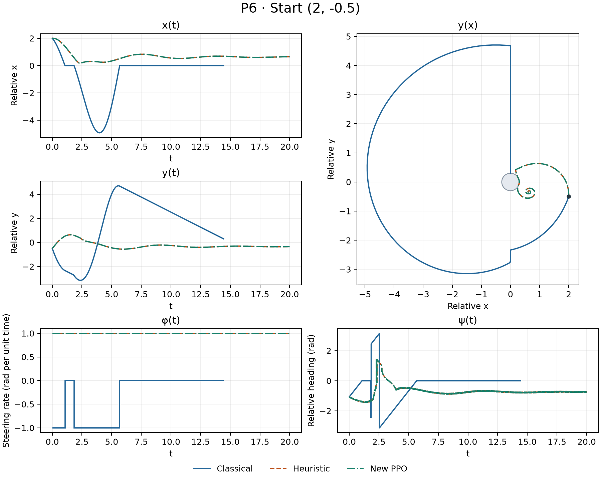
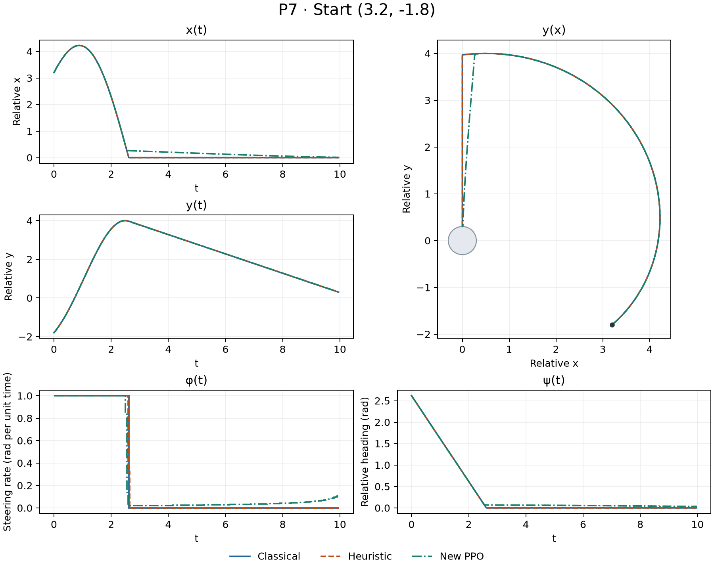
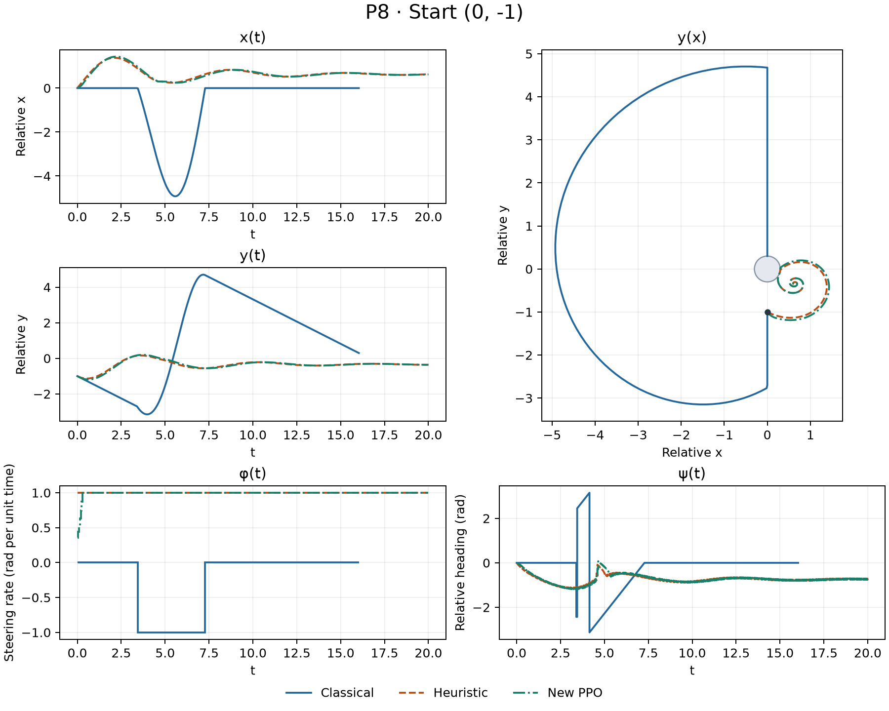

# Игра "шофер-убийца": сравнение трех стратегий

**Водитель, играющий по классической оптимальной стратегии поймал пешехода на всех 6 532 вариантах начальных условий.** PPO, обученный против классического пешехода с зазором 0.001, смог захватить пешехода в 4 045 игр (61.93 %), а эвристика прямого преследования — в 4 043 (61.90 %). На 4 043 общих захватах PPO в среднем затратил на 0,063 единицы  времени больше эвристики. Все три водителя оценивались против одной стратегии пешехода с зазором.

## 1. Описание задачи

На неограниченной плоскости шофер стремится как можно быстрее поймать пешехода, а пешеход стремится избежать захвата или отсрочить его. Скорость машины и ее минимальный радиус поворота приняты за единицу. Пешеход движется с постоянной скоростью $\gamma=0.5$ и может мгновенно менять курс (направление движения).

Координаты $(x,y)$ задают положение пешехода относительно машины. Ось $y$ направлена вперед по курсу машины, ось $x$ — вправо. Водитель выбирает угловую скорость $\phi\in[-1,1]$, где положительное значение означает правый поворот. Курс пешехода $\psi$ отсчитывается по часовой стрелке от курса машины. В этих координатах движение описывают уравнения

$$
\dot x=-\phi y+\gamma\sin\psi,\qquad
\dot y=-1+\phi x+\gamma\cos\psi.
$$

Захват происходит при первом контакте с кругом радиуса $\beta=0.3$ вокруг машины. Учитывается касание между узлами сетки  и ровно в конце горизонта, при $T=20$. 

## 2. Стратегии управления

**Классический убегающий** определяет по текущему положению дугу решения Мерца и берет курс из ее геометрии. С зазором $\varepsilon=0.001$ он использует защитный барьер и виртуальную окружность радиуса $\beta+\varepsilon=0.301$. При нехватке места эффективный зазор уменьшается. На безопасной дуге пешеход может двигаться вдоль виртуальной окружности, сохраняя расстояние до истинной границы захвата. Прямо перед машиной он бежит по ее курсу. На линии рассеяния выбор между двумя продолжениями зависит от знака фактически примененного руля. 

**Классический водитель** выбирает маневр по положению цели относительно барьера и линий переключения решения Мерца. На быстрой стороне барьера он поворачивает к цели с предельной угловой скоростью. На другой стороне может сначала отвернуть, чтобы выйти на ось позади машины. Когда пешеход прямо впереди, водитель едет прямо на него. 
**Эвристика прямого преследования** на каждом шаге берет угол до цели $\alpha=\operatorname{atan2}(x,y)$, делит его на номинальную длительность шага 0,05 и ограничивает результат диапазоном руля $[-1,1]$. Если цель строго сзади, водитель поворачивает вправо.

## 3. PPO и обучение

Используем метод обучения с подкреплением PPO для игры за шофера. Action агента —  это выбор угловой скорости (угла поворота руля). Сеть получает шесть признаков — масштабированные координаты $x$, $y$ и расстояние $r$, компоненты направления $x/r$ и $y/r$, а также долю оставшегося времени. Для первых трех признаков используется преобразование $f(z)=(2/\pi)\arctan(z/4)$. Актор с двумя скрытыми слоями по 64 нейрона задает среднее нормального распределения действия и обучает его разброс. Отдельный критик со слоями по 32 нейрона оценивает ожидаемую дисконтированную награду. Общее количество параметров  — 5 987.

**Структура награды.** За переход из состояния $ s_t $ в состояние $ s_{t+1} $ водитель получает награду

$$
r_t = \mathbf{1}_{\{\text{захват на шаге }t\}}
      - \frac{\Delta t}{20}
      + 0.99\,\Phi(s_{t+1}) - \Phi(s_t)
$$

Первое слагаемое равно 1, если на этом шаге произошёл захват, и 0 в противном случае. Второе — штраф за фактически прошедшее на шаге время $\Delta t$. Третье слагаемое учитывает изменение потенциала $\Phi$ с коэффициентом дисконтирования 0,99. Потенциал растёт при сближении водителя и цели и равен нулю в конечном состоянии.

Начальные положения для обучения выбираются равномерно из области квадрата $[-4,4]^2$ за пределами круга захвата.  После каждых 1 024 решений PPO выполнял 10 эпох обновления мини-батчами по 64. Скорость обучения составляла 0.0003, скидка за решение — 0.99. 

## 4. Методика сравнения стратегий

Все три водителя начинали с одних и тех же точек сетки с шагом 0.1 в квадрате $[-4,4]^2$. После исключения круга захвата вместе с границей остается 6 532 возможных начальных условий. Во всех эпизодах пешеход играет по классической стратегии с зазором 0.001. Шаг дискретизации 0.05. На каждом шаге угловая скорость машины и абсолютный курс пешехода считаются постоянными, поэтому относительный курс пешехода меняется по закону $\dot\psi=-\phi$. 

Основная метрика — доля всех стартов с захватом к $T=20$. Эпизод без контакта к этому сроку считается тайм-аутом. Среднее время для каждого водителя рассчитано по его захватам.

## 5. Результаты на 6 532 начальных условиях

| Водитель | Захваты | Тайм-ауты | Доля захватов | Среднее время до захвата, ед. мод. времени |
|---|---:|---:|---:|---:|
| Классический | 6 532 | 0 | 100.00 % | 10.944 |
| Эвристика | 4 043 | 2 489 | 61.90 % | 8.752 |
| Новый PPO | 4 045 | 2 487 | 61.93 % | 8.819 |

Цветовая шкала одинакова для всех трех водителей. Малиновый цвет обозначает тайм-аут, а белые ячейки внутри круга захвата и на его границе исключены из оценки.

PPO поймал на всех 4 043 стартах с захватом у эвристики и еще на двух стартах. На общих захватах PPO в среднем затратил **на 0.063** единицы модельного времени больше эвристики. На 4 045 общих захватах с классическим водителем PPO в среднем затратил на 0.065 больше. 

## 6. Восемь реперных траекторий

 Графики $x(t)$ и $y(t)$ показывают положение пешехода относительно машины, $y(x)$ — его путь относительно круга захвата. Графики $\phi(t)$ и $\psi(t)$ показывают угол поворота руля водителя и относительный курс пешехода. Синяя сплошная линия соответствует классическому водителю, оранжевая штриховая — эвристике, зеленая штрихпунктирная — PPO. Под рисунками указаны времена первого контакта в единицах модельного времени или тайм-аут при $T=20$. 

### P1 (0; 2.3)

Классический — 4.000, эвристика — 4.000, PPO — 4.006. Классический водитель и эвристика едут прямо вдоль оси. PPO начинает с поворота влево, затем уменьшает боковое отклонение и достигает круга чуть правее оси.

### P2 (1; 2.5)

Классический — 4.806, эвристика — 4.806, PPO — 4.813. Все три водителя начинают с предельного правого поворота. Классический водитель и эвристика продолжают погоню вдоль оси $y$. Траектория PPO проходит немного правее оси до захвата.

### P3 (0.2; 1)

Классический — 1.442629, эвристика — 1.442633, PPO — 1.443488. Все три водителя поворачивают вправо и сближаются с пешеходом почти по одной траектории. PPO достигает круга чуть правее оси, а разброс времен составляет менее 0.001.

### P4 (0.45; 1)

Классический — 18.278, эвристика и PPO — тайм-аут. Классический водитель начинает поворотом влево и после обхода догоняет пешехода вдоль оси. У эвристики и PPO совпадают управления и траектории. Начальный поворот вправо приводит пешехода к защитному барьеру, затем к безопасной дуге на расстоянии 0.301.

### P5 (0.5; 0)

Классический — 17.482, эвристика и PPO — тайм-аут. Классический водитель начинает поворотом влево и ловит пешехода после широкой дуги. У эвристики и PPO начальный поворот вправо, а траектория пешехода в относительных координатах сворачивается в спираль вне круга захвата. Минимальное расстояние в сохраненных состояниях у обоих составляет 0.359.

### P6 (2; −0.5)

Классический — 14.433, эвристика и PPO — тайм-аут. Классический водитель поворачивает влево и после широкой дуги возвращается к оси $y$. Эвристика и PPO начинают с правого поворота. У обоих пешеход движется по одной и той же траектории, достигая сначала защитного барьера, а затем безопасной дуги.

### P7 (3.2; −1.8)

Классический — 9.954, эвристика — 9.954,  PPO — 9.975. Начальная дуга совпадает на графиках. Затем классический водитель и эвристика продолжают погоню вдоль оси $y$. PPO подходит к кругу чуть правее оси и достигает его примерно на 0.021 позже.

### P8 (0; −1)

Классический — 16.036, эвристика и PPO — тайм-аут. Классический водитель сначала удаляется вдоль оси $y$ и возвращается к кругу после широкой дуги. Эвристика сразу поворачивает вправо с $\phi=1$, а PPO начинает с $\phi\approx0.359$. Обе траектории достигают виртуальной окружности и остаются вне круга захвата до конца горизонта.

## 7. Ограничения интерпретации и выводы

Классический водитель лидирует по доле захватов на сетке. Новый PPO и эвристика дают почти одинаковую долю, а преимущество PPO в два захвата сопровождается большей средней длительностью на общих успешных стартах.
На P1–P8 классический водитель поймал пешехода во всех восьми случаях. Эвристика и PPO поймали на одних и тех же четырех стартах — P1, P2, P3 и P7. В этих четырех эпизодах PPO в среднем затратил на 0,008746 единицы модельного времени больше эвристики. На P4–P6 их сохраненные траектории совпадают, а на P8 начальные повороты различаются и обе погони заканчиваются тайм-аутом. 

Выводы относятся к фиксированной стратегии пешехода с зазором, указанным параметрам игры и одному заранее выбранному набору весов PPO. Тайм-аут означает, что пешеход избегал захвата до $T=20$. Реперы иллюстрируют отдельные маневры, а доли захватов рассчитаны по полной сетке. 
